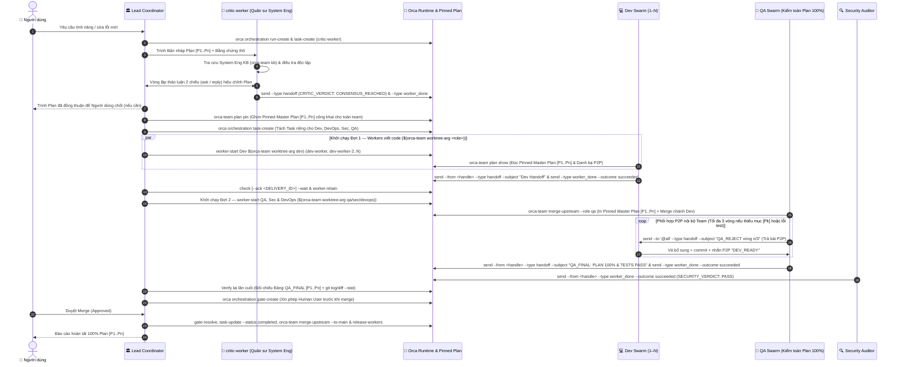
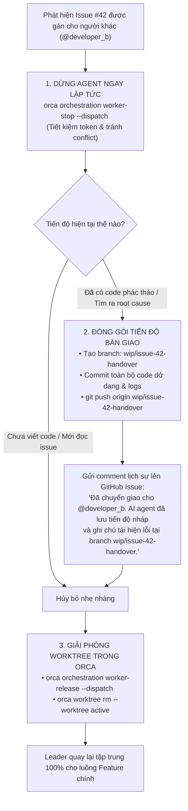
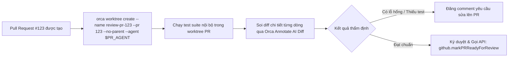
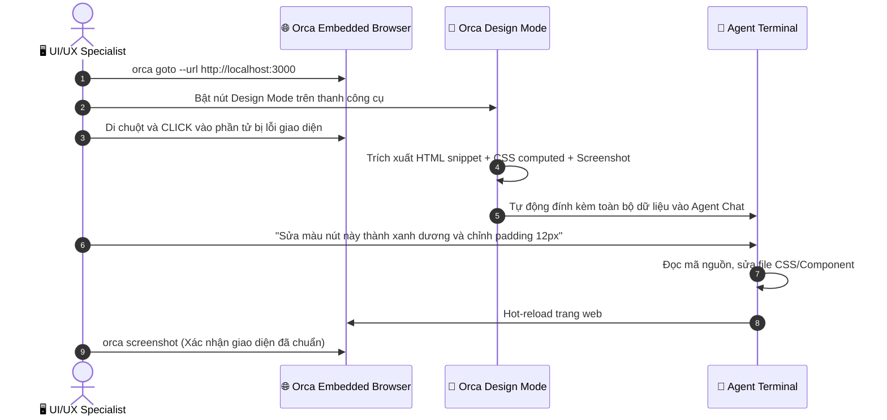
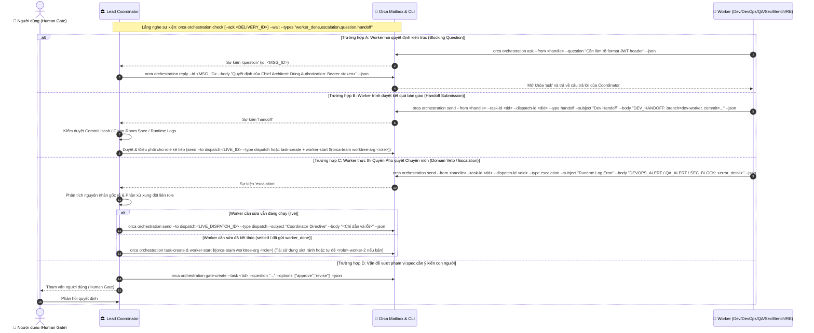
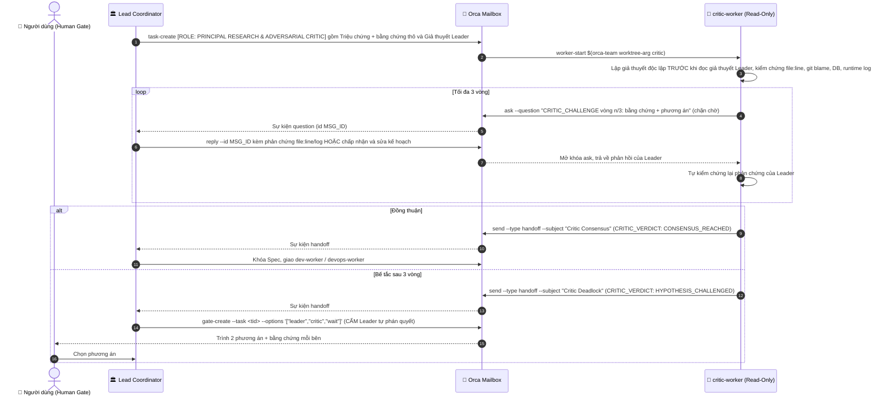
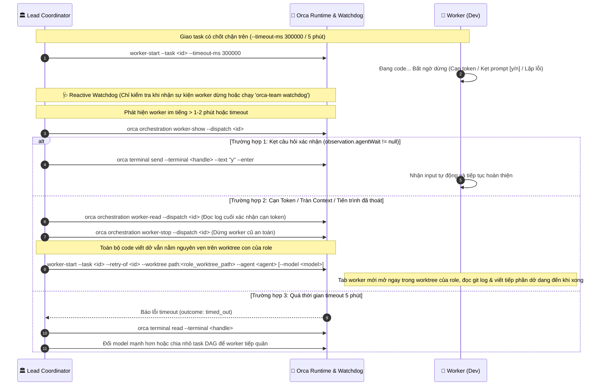

# 🔄 Sơ Đồ Quy Trình Vận Hành Chi Tiết (Workflows & Diagrams)

Tài liệu này tập hợp đầy đủ tất cả các quy trình vận hành trong hệ thống Orca Multi-Agent Orchestration dưới dạng sơ đồ Mermaid trực quan.

---

## 1. Quy Trình Phát Triển Tính Năng Mới (Feature DAG Orchestration)

Quy trình chuẩn khi tiếp nhận một yêu cầu phát triển tính năng lớn, phân rã công việc cho nhiều Dev và QA chạy song song.

---

## 2. Quy Trình Đa Luồng Song Song (Concurrent Dual-Track Policy)

Tình huống: Leader đang trong phiên điều phối/review Feature thì bất ngờ có một **GitHub Issue P0/Hotfix** được gán cho bạn.

---

## 3. Quy Trình Đổi Người & Bàn Giao (Issue Reassignment & Handoff Policy)

Tình huống: Issue #42 đang được agent sửa dở dang thì bị Project Manager gán lại cho một lập trình viên khác.

---

## 4. Quy Trình Thẩm Định Pull Request (PR Reviewer)

Sử dụng agent chuyên biệt để checkout PR vào worktree riêng, chạy kiểm tra CI và soi diff từng dòng.

---

## 5. Quy Trình Sửa Lỗi UI Với Design Mode & Embedded Browser

Khai thác tối đa tiện ích đồ họa độc quyền của Orca để sửa lỗi visual bug chỉ bằng một cú click chuột.

---

## 6. Quy Trình Ra Quyết Định Trung Tâm, Bàn Giao & Xử Lý Sự Cố (3-Tier Decision Hierarchy & Escalation)

Tình huống: Worker (Dev/DevOps/QA/Sec/Bench/RE) cần quyết định kiến trúc (`ask`), gửi kết quả bàn giao (`handoff`), hoặc thực thi Quyền Phủ quyết Chuyên môn (`escalation`) khi phát hiện lỗi Runtime Log/Security/Performance. **Lead Coordinator điều phối và ra quyết định kỹ thuật** trong các bước thực thi (Steps 1–3) nhưng chịu đối trọng của `critic-worker` khi gặp trigger Anti-Autocracy (xem mục 6.1), và **Human User** giữ quyền quyết định cuối cùng (Step 4 `gate-create`, hoặc khi Leader–Critic bế tắc).

### 6.1. Vòng Phản Biện Leader ↔ Critic (Anti-Autocracy & Dialectical Consensus)

Kích hoạt khi gặp 1 trong 4 trigger: (a) bug đã fix ≥1 lần vẫn tái phát, (b) escalation quy lỗi sang role khác hoặc bug liên tầng App ↔ DB ↔ Infra ↔ Network, (c) thay đổi schema/API contract/auth/payment hoặc chạm ≥2 tầng, (d) các worker báo cáo mâu thuẫn. Critic dùng `ask` (lệnh **chặn** tới khi Leader `reply`) nên đây là đối thoại 2 chiều thật; tối đa 3 vòng để chặn tranh cãi vô hạn đốt token.

> **Giới hạn:** Đây là ràng buộc ở tầng chỉ dẫn + kiểm tra Zero-Trust; Orca CLI không chặn cứng việc Leader bỏ qua Critic. Dấu vết kiểm toán nằm ở hộp thư Run (`orca orchestration check --json`): thiếu `Critic Consensus`/`Critic Deadlock` cho một task có trigger là vi phạm có thể phát hiện được.

---

## 7. Quy Trình Giám Sát Sức Khỏe & Xử Lý Agent Bị Treo / Cạn Token (Watchdog & Hung Worker Recovery Policy)

Tình huống: Dev hoặc QA đang làm việc thì đột ngột dừng lại giữa chừng do:
* **Hết token / Tràn context window:** Model bị cắt cụt câu trả lời hoặc provider báo lỗi giới hạn token.
* **Kẹt câu hỏi xác nhận:** Agent đang chờ xác nhận `[y/N]` hoặc xin quyền chạy lệnh từ người dùng.
* **Treo vô tận / Vòng lặp lỗi:** Agent bị kẹt trong vòng lặp linter/test hoặc script chạy ngầm không hồi kết.

### 7.1. Phân Biệt Giới Hạn Token & Chiến Lược Chuyển Nhà Cung Cấp (Cross-Provider Failover)

Khi phát hiện worker bị dừng, Leader phân tích chính xác bản chất lỗi qua `worker-read`:

1. **Tràn Context Window Phiên (Session Context Overflow):**
   * *Hiện tượng:* Agent đọc quá nhiều file hoặc log test quá dài vượt quá context window (128k/200k tokens).
   * *Giải pháp:* Khởi tạo worker tab mới (kể cả cùng model) với context sạch (`fresh context`), tiếp quản ngay trong worktree định danh của role (`--retry-of <dispatch_id> --worktree path:<role_worktree_path>`).

2. **Khóa Hạn Ngạch Toàn Tài Khoản (Account Rate Limit / HTTP 429 / Insufficient Quota):**
   * *Hiện tượng:* Tài khoản nhà cung cấp bị cạn tiền hoặc dính giới hạn request/phút (429).
   * *Nguyên tắc sống còn:* **TUYỆT ĐỐI KHÔNG spawn lại cùng nhà cung cấp** (vì sẽ lập tức thất bại tiếp).
   * *Cơ chế Cầu Dao Ngắt (Circuit Breaker):* Gắn nhãn Cooldown cho provider đó (tạm dừng 15–30 phút).
   * *Chuyển Nhà Cung Cấp Tức Thì (Cross-Provider Failover):*
     * Đang dùng **Claude** (Anthropic) ➔ Chuyển sang **Kimi** (Moonshot) hoặc **Codex** (OpenAI).
     * Đang dùng **Kimi** (Moonshot) ➔ Chuyển sang **Codex** (OpenAI) hoặc **Claude** (Anthropic).
     * Đang dùng **Codex** (OpenAI) ➔ Chuyển sang **Claude** (Anthropic) hoặc **Kimi** (Moonshot).
   * *Cập nhật cấu hình:* `orca-team set dev --agent <failover_agent>` rồi cho worker mới tiếp quản worktree hiện tại.

3. **Toàn Bộ Nhà Cung Cấp Đồng Loạt Cạn Hạn Ngạch:**
   * Bảo toàn 100% mã nguồn trên Git Worktree con.
   * Dừng an toàn mọi worker: `orca orchestration worker-stop --dispatch <id>`.
   * Báo cáo Human Gate lên giao diện chat để người dùng nạp thêm quota hoặc can thiệp.

