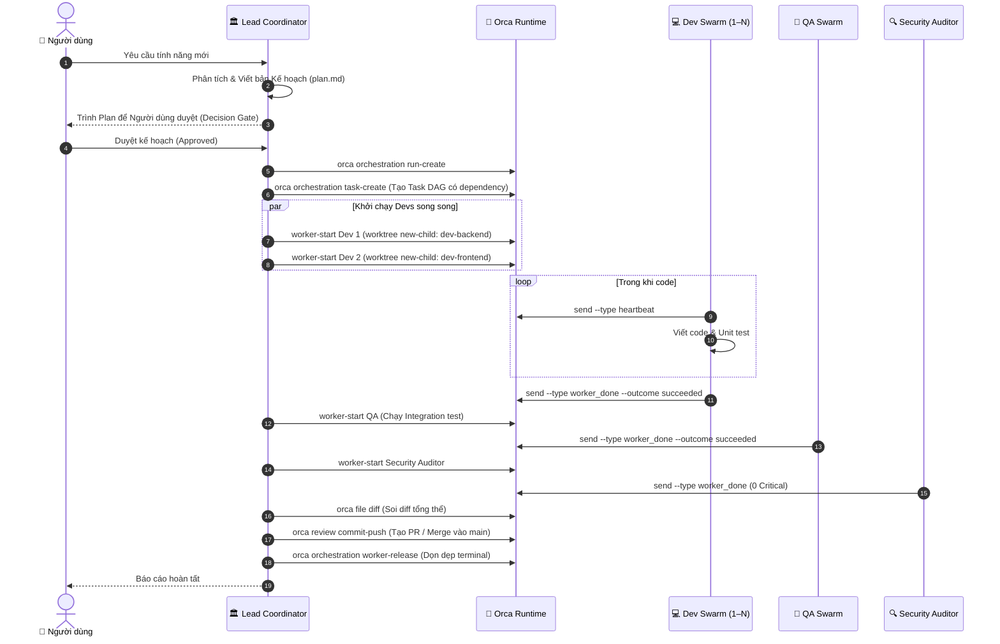
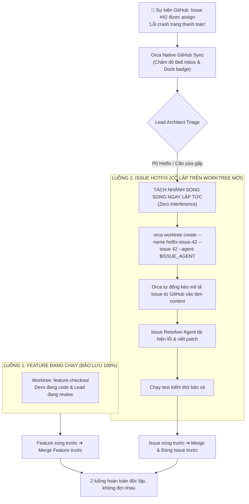
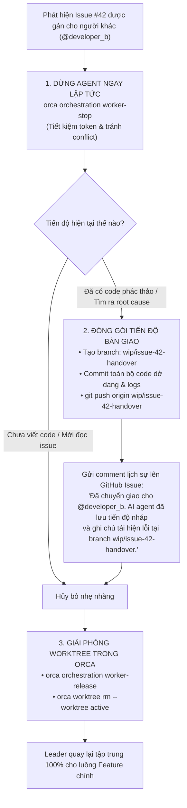
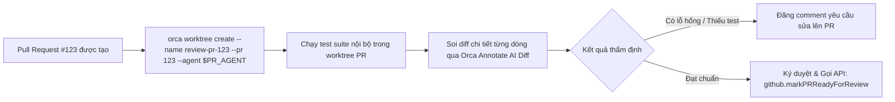
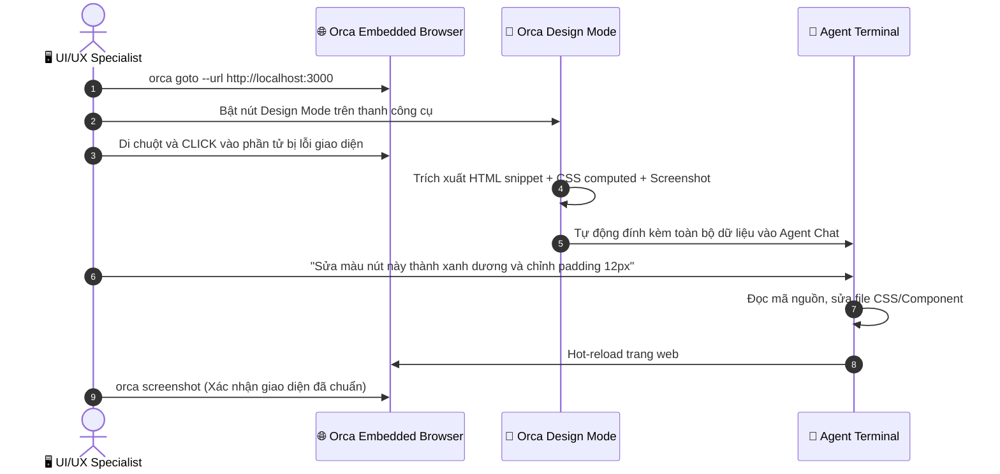

# 🔄 Sơ Đồ Quy Trình Vận Hành Chi Tiết (Workflows & Diagrams)

Tài liệu này tập hợp đầy đủ tất cả các quy trình vận hành trong hệ thống Orca Multi-Agent Orchestration dưới dạng sơ đồ Mermaid trực quan.

---

## 1. Quy Trình Phát Triển Tính Năng Mới (Feature DAG Orchestration)

Quy trình chuẩn khi tiếp nhận một yêu cầu phát triển tính năng lớn, phân rã công việc cho nhiều Dev và QA chạy song song.

---

## 2. Quy Trình Đa Luồng Song Song (Concurrent Dual-Track Policy)

Tình huống: Leader đang trong phiên điều phối/review Feature thì bất ngờ có một **GitHub Issue P0/Hotfix** được gán cho bạn.

---

## 3. Quy Trình Đổi Người & Bàn Giao (Issue Reassignment & Handoff Policy)

Tình huống: Issue #42 đang được agent sửa dở dang thì bị Project Manager gán lại cho một lập trình viên khác.

---

## 4. Quy Trình Thẩm Định Pull Request (PR Reviewer)

Sử dụng agent chuyên biệt để checkout PR vào worktree riêng, chạy kiểm tra CI và soi diff từng dòng.

---

## 5. Quy Trình Sửa Lỗi UI Với Design Mode & Embedded Browser

Khai thác tối đa tiện ích đồ họa độc quyền của Orca để sửa lỗi visual bug chỉ bằng một cú click chuột.

