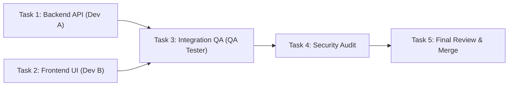

# 📋 Architecture Plan & Task Breakdown (plan.md Template)

> **Mục tiêu tính năng / Epic:** [Mô tả ngắn gọn mục tiêu cần đạt được]  
> **Người lập kế hoạch (Lead Architect):** [Agent Name / Model]  
> **Trạng thái:** [Draft / Pending Approval / In Progress / Completed]  

---

## 1. Phân Tích Hiện Trạng & Yêu Cầu Kỹ Thuật
- **Yêu cầu nghiệp vụ (Business Requirements):**
  - [ ] Yêu cầu 1...
  - [ ] Yêu cầu 2...
- **Tác động kiến trúc (Architectural Impact):**
  - Các module bị ảnh hưởng: `src/api`, `src/components`...
  - Có thay đổi Database Schema / Migrations không? [Có / Không]
  - Có API Contract mới không? [Mô tả REST/GraphQL/gRPC contract]

---

## 2. Phân Chia Nhiệm Vụ (Task Breakdown & DAG)

### Task 1: Backend Service & API Logic
* **Worker đảm nhiệm:** Full-Stack Dev (`antigravity` / `claude`)
* **Worktree định danh:** `dev-worker` (tái sử dụng `path:.../dev-worker` & gom nhóm Terminal Tab)
* **Nhiệm vụ cụ thể:**
  - Viết logic xử lý nghiệp vụ...
  - Viết Unit test với độ bao phủ > 90%...
* **Acceptance Criteria:** Unit tests pass 100%, 0 lint error.

### Task 2: Frontend Component & State Management
* **Worker đảm nhiệm:** UI/UX Specialist (`antigravity` / `claude`)
* **Worktree định danh:** `ui-worker` (tái sử dụng `path:.../ui-worker` & gom nhóm Terminal Tab)
* **Nhiệm vụ cụ thể:**
  - Tạo Component giao diện...
  - Sử dụng Orca Design Mode để căn chỉnh CSS chuẩn mockup...
* **Acceptance Criteria:** Render mượt mà, không lỗi console.

### Task 3: Integration & E2E Testing
* **Worker đảm nhiệm:** QA Tester (`kimi`)
* **Phụ thuộc (Depends on):** Task 1, Task 2
* **Nhiệm vụ cụ thể:**
  - Viết kịch bản test tích hợp kết nối Frontend & Backend...
  - Kiểm tra các ca biên: timeout, dữ liệu sai định dạng, spam request...
* **Acceptance Criteria:** Toàn bộ integration test suite pass.

### Task 4: Security Audit & Code Review
* **Worker đảm nhiệm:** Security Auditor (`codex` / `claude`)
* **Nhiệm vụ cụ thể:**
  - Rà soát OWASP Top 10, Auth/RBAC, rò rỉ secret...
* **Acceptance Criteria:** 0 cảnh báo mức High / Critical.

---

## 3. Cổng Duyệt Của Người Dùng (Human-in-the-Loop Sign-off)

- [ ] Người dùng đã xem và phê duyệt bản kế hoạch này: **[Chờ duyệt / Đã duyệt]**
*(Chỉ khi người dùng duyệt, Lead mới bắt đầu gọi lệnh `worker-start` để triển khai)*
