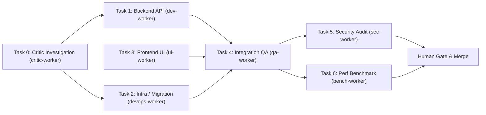

# 📋 Architecture Plan & Task Breakdown (plan.md Template)

> **Mục tiêu tính năng / Epic:** [Mô tả ngắn gọn mục tiêu cần đạt được]  
> **Người lập kế hoạch (Lead Architect):** [Agent Name / Model]  
> **Trạng thái:** [Draft / Pending Approval / In Progress / Completed]  

---

## 1. Phân Tích Hiện Trạng & Yêu Cầu Kỹ Thuật
- **Yêu cầu nghiệp vụ (Business Requirements):**
  - [ ] Yêu cầu 1...
  - [ ] Yêu cầu 2...
- **Tác động kiến trúc (Architectural Impact):**
  - Các module bị ảnh hưởng: `src/api`, `src/components`...
  - Có thay đổi Database Schema / Migrations không? [Có / Không]
  - Có API Contract mới không? [Mô tả REST/GraphQL/gRPC contract]

---

## 2. Phân Chia Nhiệm Vụ (Task Breakdown & DAG)

### Task 0: Research & Adversarial Critic (Khi chạm Trigger Anti-Autocracy)
* **Worker đảm nhiệm:** Research & Adversarial Critic (`critic-worker` — Read-Only 100%)
* **Worktree định danh:** `critic-worker` (tái sử dụng `path:.../critic-worker` & gom nhóm Terminal Tab)
* **Nhiệm vụ cụ thể:**
  - Lập giả thuyết độc lập từ bằng chứng thô trước khi đọc giả thuyết của Leader...
  - Tranh biện hai chiều qua `orca orchestration ask` / `reply` (tối đa 3 vòng) và chốt `CRITIC_VERDICT: CONSENSUS_REACHED` hoặc `HYPOTHESIS_CHALLENGED`...

### Task 1: Backend Service & API Logic
* **Worker đảm nhiệm:** Full-Stack Dev (`antigravity` / `claude`)
* **Worktree định danh:** `dev-worker` (tái sử dụng `path:.../dev-worker` & gom nhóm Terminal Tab)
* **Nhiệm vụ cụ thể:**
  - Viết logic xử lý nghiệp vụ...
  - Viết Unit test với độ bao phủ > 90%...
* **Acceptance Criteria:** Unit tests pass 100%, 0 lint error, gửi `handoff` kèm Commit Hash.

### Task 2: Infrastructure, Docker/K8s & DB Migration (Nếu có)
* **Worker đảm nhiệm:** DevOps / SRE Specialist (`devops-worker`)
* **Worktree định danh:** `devops-worker` (tái sử dụng `path:.../devops-worker` & gom nhóm Terminal Tab)
* **Nhiệm vụ cụ thể:**
  - Cập nhật Dockerfile multi-stage / K8s probes / DB migration idempotent...
  - Quét 100% Runtime Logs trên toàn bộ container/pod sau chu kỳ chạy thật...
* **Acceptance Criteria:** Build & rollout sạch, Runtime Logs không có ERROR/Exception/FATAL.

### Task 3: Frontend Component & State Management (Nếu có)
* **Worker đảm nhiệm:** UI/UX Specialist (`ui-worker`)
* **Worktree định danh:** `ui-worker` (tái sử dụng `path:.../ui-worker` & gom nhóm Terminal Tab)
* **Nhiệm vụ cụ thể:**
  - Tạo Component giao diện chuẩn Responsive & a11y...
  - Sử dụng Orca Design Mode để căn chỉnh CSS chuẩn mockup...
* **Acceptance Criteria:** Render mượt mà, không lỗi console, gửi `handoff` kèm Commit Hash.

### Task 4: Integration & E2E Testing
* **Worker đảm nhiệm:** QA Tester (`qa-worker`)
* **Worktree định danh:** `qa-worker` (tái sử dụng `path:.../qa-worker` & gom nhóm Terminal Tab)
* **Phụ thuộc (Depends on):** Task 1, Task 2, Task 3
* **Nhiệm vụ cụ thể:**
  - Viết kịch bản test tích hợp kết nối Frontend & Backend & kiểm toán Runtime Logs...
  - Kiểm tra các ca biên: timeout, dữ liệu sai định dạng, race condition...
* **Acceptance Criteria:** Toàn bộ integration test suite pass (`QA_VERDICT: PASS`).

### Task 5: Security Audit & Code Review
* **Worker đảm nhiệm:** Security Auditor (`sec-worker`)
* **Worktree định danh:** `sec-worker` (tái sử dụng `path:.../sec-worker` & gom nhóm Terminal Tab)
* **Nhiệm vụ cụ thể:**
  - Rà soát OWASP Top 10, Auth/RBAC, Concurrency, Memory/Secret Leaks...
* **Acceptance Criteria:** 0 cảnh báo mức High / Critical (`SECURITY_VERDICT: PASS`).

### Task 6: Performance Benchmark & Reverse Engineering (Tùy chọn theo bài toán)
* **Worker đảm nhiệm:** Benchmark Specialist (`bench-worker`) / Reverse Engineer (`re-worker`)
* **Nhiệm vụ cụ thể:**
  - `bench-worker`: Đo Throughput (RPS/EPS), Latency (p50/p95/p99), chốt `PERF_VERDICT: PASS`.
  - `re-worker`: Dịch ngược binary/artifact hộp đen bằng `morluto/rea`, xuất Clean-Room Spec (`RE_VERDICT: EVIDENCE_COMPLETE`).

---

## 3. Cổng Duyệt Của Người Dùng (Human-in-the-Loop Sign-off)

- [ ] Người dùng đã xem và phê duyệt qua `orca orchestration gate-create`: **[Chờ duyệt / Đã duyệt]**
*(Chỉ khi người dùng phản hồi `"yes"`, Lead mới đóng Gate, merge vào nhánh chính và gọi `worker-release`)*
